# How this video was made: titanox-4322150818097424.mp4

**How it was made**: Mixed production: live action 68% + AI-generated video 22% + code / template render 10%

- 0:11 · vertical 9:16 · 6 shots, 1.9s each on average
- Confidence 57%, based on: tool measurements + AI assistant reviewed 6 shots
- ⚠️ 6 points are uncertain, see “Open questions”

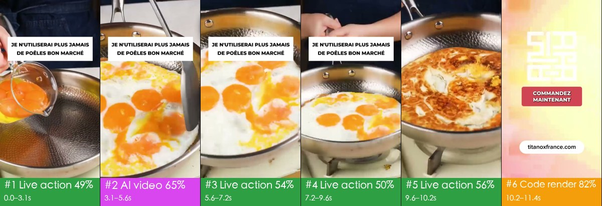

# Part one · Breakdown: how this video is built

## At a glance: picture, packaging, sound

Any short video splits into three layers: the picture, what is laid on top of it (subtitles, styled text, stickers), and the sound. Remake it one layer at a time.

| Layer | In this video | How to make it | Detail |
|---|---|---|---|
| **Picture** (base) | live action 4 shots, AI-generated video 1 shot, code / template render 1 shot | filmed in 1 scene; AI in 1 generation; screen recording / motion graphics in code | “Remake it yourself” |
| **Packaging** (on top) | subtitle, text | add in the editor: subtitles, styled text and stickers by the timeline | “Packaging layer” |
| **Sound** | voice（human recording）, 1 sound effects | voice: record it yourself; effects: add from a library at the listed times | “Sound” |

## Content and structure

- No narrative line this time (what each shot is doing in the story needs AI image reading); the “Picture” column of the shot list is a start

**Script** (local speech recognition, unchecked; trust on-screen subtitles for names and homophones)

| Time | Who | Line | Delivery |
|---|---|---|---|
| 3.4–5.9s | narration | The. | measured: rate slow (0.4 words/s) |

## Shot list

| # | Frame | Time | Picture | Camera | Made with |
|---|---|---|---|---|---|
| 1 | 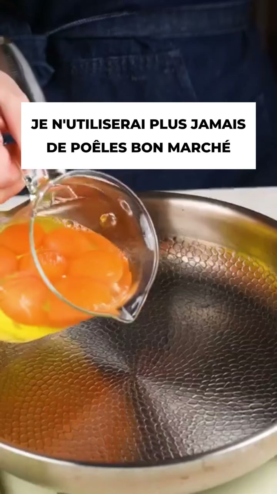 | 0:00.0 · 3.1s | Œufs versés depuis un verre doseur dans la poêle vide, titre… | smooth move | live action |
| 2 | 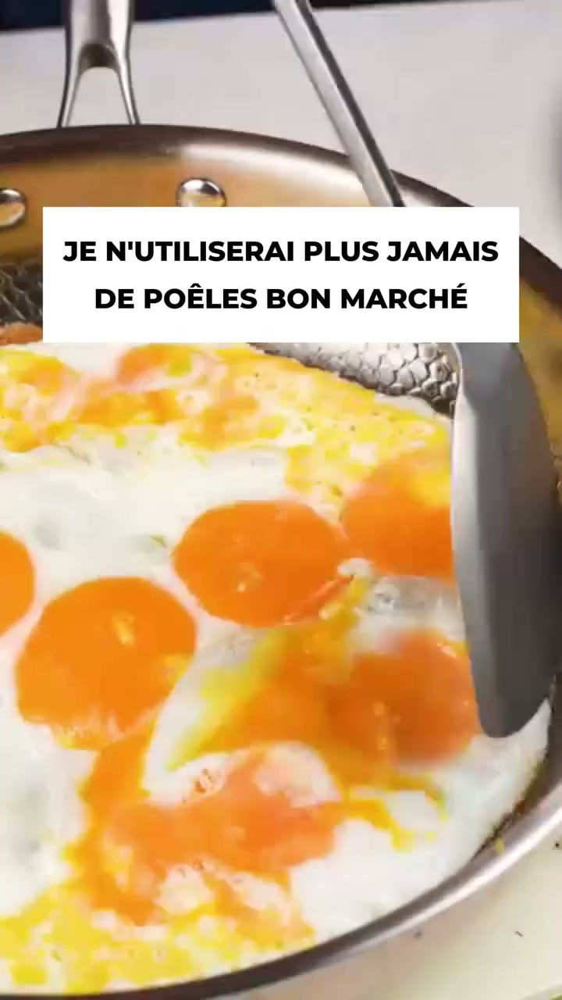 | 0:03.1 · 2.5s | Gros plan : une dizaine d'œufs au plat, une spatule glisse d… | smooth move | AI-generated video |
| 3 | 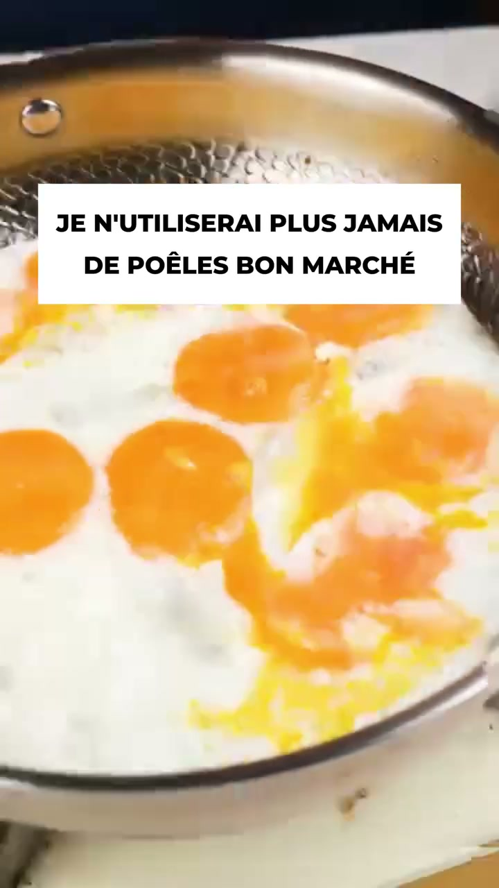 | 0:05.6 · 1.6s | Les œufs glissent dans la poêle inclinée | static (subject moves) | live action |
| 4 | 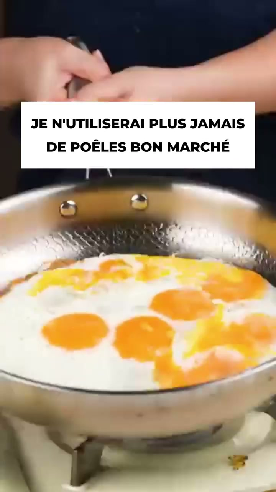 | 0:07.2 · 2.4s | La poêle est retournée : la galette d'œufs saute et retombe … | smooth move | live action |
| 5 | 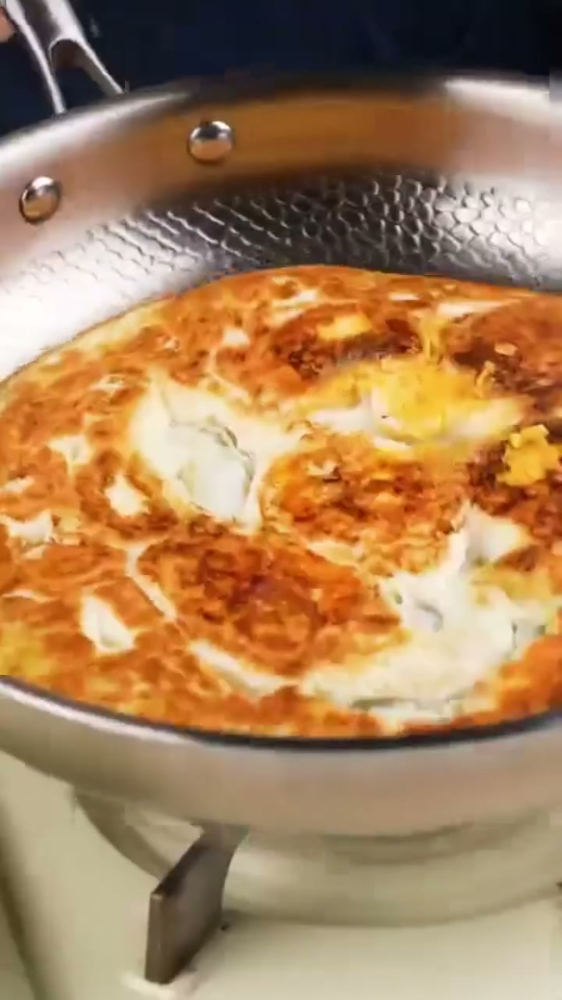 | 0:09.6 · 0.6s | Plan final sur la galette dorée dans la poêle | smooth move | live action |
| 6 | 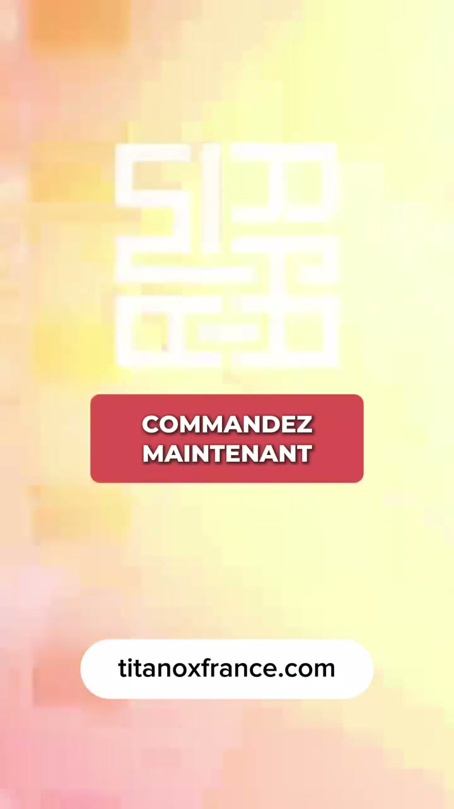 | 0:10.2 · 1.1s | Carte de fin : logo, bouton « Commandez maintenant », adress… | static | code / template render |

## Cast, scenes and props

- No cast extracted this time (needs AI image reading); shots where the face detector saw a face (person or character): #4

## Camera and lighting

- Framing: shot size medium shot 72%, medium close-up 28%; subject is the in-focus region (no face; shot size is an estimate)
- Camera: moving camera (gimbal / handheld pan) 79%, fixed camera (tripod / mount / on the desk) 21%; typical move pull-out
- Lighting: soft frontal light (flat light). Key light frontal (from the camera side; both sides of the subject about equally bright), at subject height; lighting ratio about 1.0:1 (0.1 stops); soft light (almost no lit / shadow edge); colour temperature neutral (about 5000K); subject and background differ in colour temperature: mixed sources (e.g. warm lamp + cool window light / screen); background clearly blurred (shallow depth of field / portrait mode)
- Grade: natural (close to the original colours); normal saturation, high contrast, normal blacks, overall warm
- Format: handheld product shots (unboxing / selling / POV) (face as subject 0%, objects / hands as subject 100%, handheld 79%)

<details class="ref"><summary>Per-item measurements and image readings (6)</summary>

| Aspect | Item | Verdict | Sources |
|---|---|---|---|
| Framing | shot size | medium shot | measured |
| Camera | camera support | moving camera (gimbal / handheld pan) | measured |
| Lighting | soft / hard | soft light (almost no lit / shadow edge) | measured |
| Lighting | colour temperature | neutral (about 5000K) | measured |
| Grade | colour grade | natural (close to the original colours) | measured |
| Format | video format | handheld product shots (unboxing / selling / POV) | measured |

- Note: lighting ratio, soft / hard, colour temperature and shot size are measured on the subject's pixels (the face when there is one, otherwise the in-focus region, which is an estimate); platform transcodes crush the shadows, so hardness and fill read conservative; camera angle, light source, catchlight and rim light follow the image readers. Where measurement and readers disagree, both are listed.

</details>

## Packaging layer (subtitles / styled text / stickers / sound-effect hits)

- title ×2: "JEN'UTILISERAI", "DE POELES BON "
- SFX hits on: title in ×1

<details class="ref"><summary>text timeline (2 rows)</summary>

| Time | Kind | Text | Style | In / out | SFX |
|---|---|---|---|---|---|
| 0.00–9.00s | title | JEN'UTILISERAIPLUSJAMAIS | black text, line height 2.3% (about 30px) | hard out | ding |
| 0.00–9.00s | title | DE POELES BON MARCHE | black text, line height 3.0% (about 39px) | hard out | — |

</details>

- Remake: import `packaging/subtitles.srt` into your editor and put in your own words; the styled version is `packaging/overlays.ass`

## Sound

**Voice**

- female-leaning
- Source: human recording
- Remake: record it yourself: phone or lavalier mic close to the mouth, in a quiet room; rewrite the lines from the script table

**Sound effects** (1)

| Sound | Listen | Type | Times used | At | On screen |
|---|---|---|---|---|---|
| F1 | [listen](sfx/sfx_01.wav) | ding | 1 | 0.1s | title "JEN'UTILISERAIPL" appears |

- Remake: play each sound, find a similar one in your editor's library and place it at the times under “At”

**Listen to the tracks**

- voice: [stems/vocals.wav](stems/vocals.wav)

<details class="ref"><summary>Sound measurements and evidence</summary>

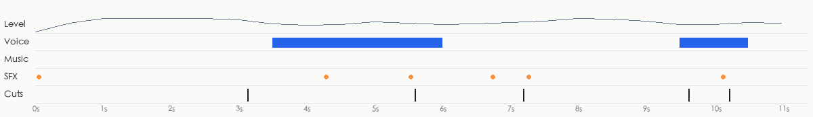

- Loudness -22.0 dBFS, peak -3.1 dBFS
- each clip carries its own sound (background jumps 4.9dB at cuts vs 2.9dB within shots)
- Voice on 31% of the duration, pitch about 393.8Hz
- Voice source: human recording (human recording 73%, TTS voice-over 20%, native dialogue from the AI video model 7%)
  - 68% of the picture is live footage: the voice is most likely location sound or a human voice-over

</details>

## Open questions

- Shot #1 (0.0–3.1s): live action at only 49% confidence, runner-up AI-generated video
- Shot #2 (3.1–5.6s): Tools say AI-generated video, the image review says live action; on the AI / live-action axis the fusion follows the tools (eval-calibrated): check the frames to see whether the review's evidence is really visible
- Shot #3 (5.6–7.2s): live action at only 54% confidence, runner-up AI-generated video
- Shot #4 (7.2–9.6s): live action at only 50% confidence, runner-up AI-generated video
- Shot #5 (9.6–10.2s): live action at only 56% confidence, runner-up AI-generated video
- No AI listened to the soundtrack (the review covered the picture only): real voice versus TTS is inferred from the waveform; the effects were found on the separated effects track and their types are estimated from the sound. Play the stems and each effect under “Sound” to check

# Part two · Remake plan

Planned for **MiniMax H3 / H3 Max**: ≤15 s per call, several shots per call, takes reference video (3 clips, ≤15 s in all), ≤9 reference images, first / last frame, native sound. Name another model and the split, lengths and prompts are redone for it.

## Remake it yourself: do it in this order

Copy the method and the rhythm, not the pictures: keep what each part does and fill it with your own content and material.

This is a tabletop / unboxing / product. Do the steps in this order; the detail for each is in the matching subsection below.

1. **Write the content**: replace the original's 1 lines with your own (script table under “Sound”); pictures follow the shot list
2. **Shoot**: phone held vertical, mostly medium shot; light: soft frontal light (flat light) — a large source from the camera side, almost no shadow on the subject: facing a window, a ring light, or a big softbox behind the camera, one large soft light straight above the desk / behind the camera (or two, symmetrical at 45°); grade: natural (close to the original colours) (setups under “Shoot”)
3. **Generate**: 1 call (2 s), several shots each. Each shot gets one source frame for composition (subtitles erased, in `remake/refs/`), the swapped-in people, animals and products get reference images, and the prompt lists the shots in order
4. **Adapt the prompts to your model**: the prompts in this report are generic, and every model reads them differently (how shots are split, how references are addressed, how dialogue is written). Before generating, rewrite them following the official prompt guide of the model you actually use, or have the agent refine them with that model's prompting skill; notes for MiniMax H3 / H3 Max at the top of “AI generation”
5. **Voice**: the original is human recording; record it yourself or use TTS; 1 lines with their pace in the script table under “Sound”
6. **Edit**: follow the order and lengths in the shot list; the original has 6 shots at 1.9s each; 1 transitions under “Edit”
7. **Subtitles and styled text**: timing and style under “Packaging layer”
8. **Sound effects**: 1; place similar ones from a library at the times under “Sound”
9. **Put it together and compare**: hand the shots you made to the agent; it places them on the original timeline, keeps the original where yours are missing, and renders a side-by-side comparison with the original

### Shoot

Shoot every shot of one scene before moving to the next; within a scene, shoot the wider sizes first and the close-ups last so the lighting is set only once. Leave about 1s of handle at both ends of every take.

**S1**: shots #1, #3–#5 (7.77s on screen); Œufs versés depuis un verre doseur dans la poêle vide, titre incrusté
- Lighting: soft frontal light (flat light), key light frontal, cool (daylight / cool-white LED)
- Setup medium shot · moving camera (gimbal / handheld pan) · pull-out/push-in: shots #1, #4, 5.57s on screen, shoot about 9.6s
- Setup medium close-up · fixed camera (tripod / mount / on the desk) · static: shots #3, 1.6s on screen, shoot about 3.6s
- Setup medium close-up · moving camera (gimbal / handheld pan) · pull-out: shots #5, 0.6s on screen, shoot about 2.6s

Gear (inferred from the measured light):
- one large soft light straight above the desk / behind the camera (or two, symmetrical at 45°)
- white desk or white cards to bounce; shadows go lighter

### AI generation

**1 generation, 2 s in total**

> ⚠️ G1: the prompts are still generic drafts. Rewrite them in MiniMax H3 / H3 Max's official format (or have the agent write them with that model's prompting skill) into `remake/prompts.json`, numbering images in the unit's reference order; `rea-video plan` then checks the format.

| Part | Shots | Time | Length | Prepare |
|---|---|---|---|---|
| G1 | #2 | 3.1–5.6s | generate 4s, trim to 2.5s | reference images |

<details class="ref"><summary>Why it is split this way</summary>

- Grouping: consecutive shots share a call where they fit, ≤15s per call, ≤4 shots; a long stretch is cut at a scene change first
- Inputs: the model takes no reference video: one source frame per shot (subtitles erased) fixes composition, swapped-in things get their own images
- Audio: the model can generate action sound effects and ambience along with the picture; the voice was recorded by a person: record it separately and mix it in rather than having the video model speak, so copy and timing stay editable
- Packaging: the title on the generated shots is post-production packaging: keep it out of the prompts (erased from source references) and lay it back on from the packaging timeline after generation

</details>

<details><summary>G1 · shots #2 · 2.5s</summary>

- reference images: source frames of shots #2 (subtitles erased)

Draft prompt (generic; rewrite it in MiniMax H3 / H3 Max's format into remake/prompts.json before generating):

```text
Generate the shots below in order in one go, hard cuts between them; each shot takes composition, size and camera from its source frame image. Vertical 9:16; high key (bright overall, almost no shadows), soft light (almost no lit / shadow edge), warm (about 3000–4000K), background clearly blurred (shallow depth of field / portrait mode). No subtitles, captions or watermarks in the picture.
Gros plan : une dizaine d'œufs au plat, une spatule glisse dessous (composition: @图片1)
```

</details>

### Code build

Rebuild it as one project in an HTML video framework (such as HyperFrames or Remotion): cuts, transitions and each shot's key frames from "Rhythm and key frames", layout, colours and elements from the scenes below. Text and UI are 100% controllable, changing copy is a data change, and an AI coding assistant can write the project.

`rea-video code-remake <breakdown folder>` only makes a quick draft: it renders `code/remake.mp4` from each scene's sampled points / cut-out, motion and background glow and scores it. Particles, point clouds and data visualisations on a dark ground come close; an illustrated character's acting and morph transitions do not.

- Part 1: shots #6 (10.2–11.4s)

How to build the pictures (by the measured picture type):
- vector shapes: SVG shapes + interpolate() / spring() keyframes, positions and timing measured from the frame

| Shot | Time | Build | Picture | Camera | Colours | On-screen text |
|---|---|---|---|---|---|---|
| #6 | 10.2–11.4s | vector shapes | Carte de fin : logo, bouton « Commandez maintenant », adresse du site sur fond dégradé rose | static | white, orange | titanoxfrance.com |

Per-shot motion timeline (measured: positions in % of frame width / height, colours sampled once the element settles; read together with the key-frame strip)

<details class="ref"><summary>Motion #6 10.2–11.4s (fade in) · 0 events</summary>

- No element motion measured (still picture or only slight changes)

</details>

### Edit

- Cut in the order and lengths of the shot list
- Rhythm: 26.4 cuts per minute, 1.94s average live-action shot; 3 camera set-up(s) / location(s); 0 jump cut(s) and 0 punch-in(s) within the same set-up; inserts (screenshots / screen recordings / cards / stock) take 32%; transitions cut×4, fade×1

**Transitions**

| Time | Into shot | Transition |
|---|---|---|
| 10.1–10.4s | #6 | fade, through white, 0.3s |

## Appendix

### Shot by shot

Each shot has two parts: what is visible on screen, and how the tools infer it was made (with the basis); remake prompts last. Folded by default.

<details class="ref"><summary>#1 00:00.000–00:03.133 · live action + code / editor overlays (subtitles); brings in real material (live footage)</summary>

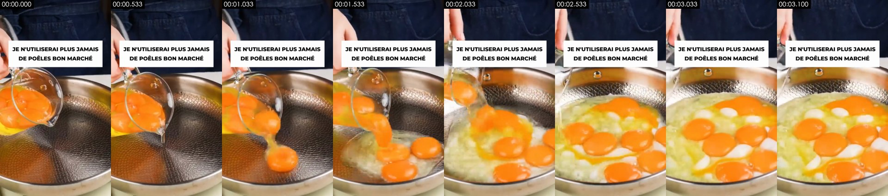

**Visible on screen** (check against the frames)
- Picture: Œufs versés depuis un verre doseur dans la poêle vide, titre incrusté
- Camera / lighting: medium shot; moving camera (gimbal / handheld pan); soft frontal light (flat light); key light frontal (from the camera side; both sides of the subject about equally bright); lighting ratio about 1.0:1 (0.0 stops); soft light (almost no lit / shadow edge)
- Text track (subtitle/middle): JEN'UTILISERAIPLUSJAMAIS / DE POELES BON MARCHE
- [AI assistant review] Mouvements physiques cohérents : la spatule glisse sous les œufs, le retournement en l'air a un flou de mouvement naturel et la face cuite est dorée de façon plausible
- [AI assistant review] Même poêle martelée, même gazinière blanche et même décor sombre sur tous les plans, sans déformation de la main ni du manche
- [AI assistant review] Profondeur de champ courte et lumière chaude de studio : allure de vidéo produit fournisseur, recadrée en 9:16 ; probabilité IA non nulle car l'image est très propre

**How it was made, as inferred by the tools** (inferred, not seen)
- Inference: live action 47%, AI-generated video 40%, 3D render 4% (fused_agent)
- Material: the user's real material: live footage
- Basis (tool measurements, not necessarily visible to the eye):
  - Photographic texture: noise σ=0.26, 233 colours, 12% flat blocks
  - Per-frame sharpness oscillates periodically (period 4 frames, correlation 0.87) with no duplicate frames: frame interpolation / rate conversion, or just the rhythm of a re-encode (transcodes whose platform tags were stripped show it too); not enough on its own to call AI

- Remake: Source is live action: reshoot per the shooting plan (shot size / camera setup / lighting); only fall back to AI image-to-video (first frame as reference) when a shoot is not possible; real material the user must supply: live footage (whole frame)

</details>

<details class="ref"><summary>#2 00:03.133–00:05.600 · AI-generated video + code / editor overlays (subtitles)</summary>

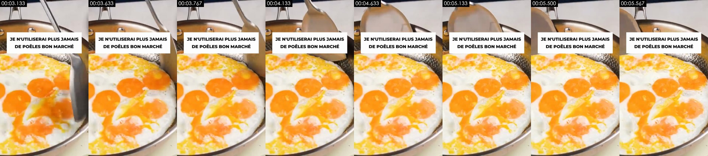

**Visible on screen** (check against the frames)
- Picture: Gros plan : une dizaine d'œufs au plat, une spatule glisse dessous
- Camera / lighting: medium close-up; moving camera (gimbal / handheld pan); high key (bright overall, almost no shadows); key light frontal (from the camera side; both sides of the subject about equally bright); lighting ratio about 1.1:1 (0.1 stops); soft light (almost no lit / shadow edge)
- Text track (subtitle/middle): JEN'UTILISERAIPLUSJAMAIS / DE POELES BON MARCHE
- [AI assistant review] Mouvements physiques cohérents : la spatule glisse sous les œufs, le retournement en l'air a un flou de mouvement naturel et la face cuite est dorée de façon plausible
- [AI assistant review] Même poêle martelée, même gazinière blanche et même décor sombre sur tous les plans, sans déformation de la main ni du manche
- [AI assistant review] Profondeur de champ courte et lumière chaude de studio : allure de vidéo produit fournisseur, recadrée en 9:16 ; probabilité IA non nulle car l'image est très propre

**How it was made, as inferred by the tools** (inferred, not seen)
- Inference: AI-generated video 65%, 3D render 18%, live action 6% (fused_agent)
- ⚠️ To confirm: AI or live action, to confirm: only a sharpness rhythm and no duplicate frames (re-encodes leave it too), the image reader calls it live action, and there is no AIGC label
- ⚠️ Disputed: Tools say AI-generated video, the image review says live action; on the AI / live-action axis the fusion follows the tools (eval-calibrated): check the frames to see whether the review's evidence is really visible
- Material: AI-generated
- Basis (tool measurements, not necessarily visible to the eye):
  - Photographic texture: noise σ=0.22, 156 colours, 15% flat blocks
  - Per-frame sharpness oscillates periodically (period 4 frames, correlation 0.46) with no duplicate frames: frame interpolation / rate conversion, or just the rhythm of a re-encode (transcodes whose platform tags were stripped show it too); not enough on its own to call AI

- Remake: Source is AI-generated: remake it with a video model; which shots share a call and what it is fed (the source clip, keyframes or first / last frames) depend on the chosen model, see the generation units in the remake plan

</details>

<details class="ref"><summary>#3 00:05.600–00:07.200 · live action + code / editor overlays (subtitles); brings in real material (live footage)</summary>

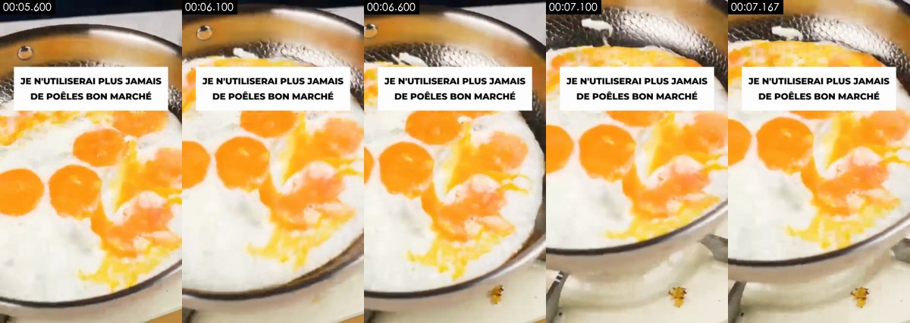

**Visible on screen** (check against the frames)
- Picture: Les œufs glissent dans la poêle inclinée
- Camera / lighting: medium close-up; fixed camera (tripod / mount / on the desk); soft frontal light (flat light); key light frontal (from the camera side; both sides of the subject about equally bright); lighting ratio about 1.1:1 (0.1 stops); soft light (almost no lit / shadow edge)
- Text track (subtitle/middle): JEN'UTILISERAIPLUSJAMAIS / DE POELES BON MARCHE
- [AI assistant review] Mouvements physiques cohérents : la spatule glisse sous les œufs, le retournement en l'air a un flou de mouvement naturel et la face cuite est dorée de façon plausible
- [AI assistant review] Même poêle martelée, même gazinière blanche et même décor sombre sur tous les plans, sans déformation de la main ni du manche
- [AI assistant review] Profondeur de champ courte et lumière chaude de studio : allure de vidéo produit fournisseur, recadrée en 9:16 ; probabilité IA non nulle car l'image est très propre

**How it was made, as inferred by the tools** (inferred, not seen)
- Inference: live action 52%, AI-generated video 34%, 3D render 4% (fused_agent)
- Material: the user's real material: live footage
- Basis (tool measurements, not necessarily visible to the eye):
  - Photographic texture: noise σ=0.21, 150 colours, 15% flat blocks

- Remake: Source is live action: reshoot per the shooting plan (shot size / camera setup / lighting); only fall back to AI image-to-video (first frame as reference) when a shoot is not possible; real material the user must supply: live footage (whole frame)

</details>

<details class="ref"><summary>#4 00:07.200–00:09.633 · live action + code / editor overlays (subtitles); brings in real material (live footage)</summary>

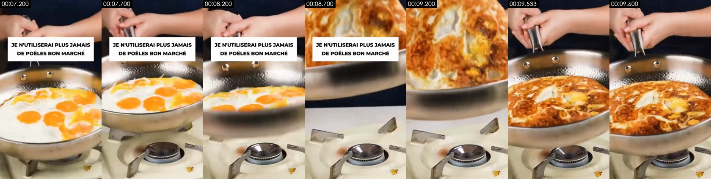

**Visible on screen** (check against the frames)
- Picture: La poêle est retournée : la galette d'œufs saute et retombe dorée
- Camera / lighting: medium shot; moving camera (gimbal / handheld pan); soft frontal light (flat light); key light frontal (from the camera side; both sides of the subject about equally bright); lighting ratio about 1.0:1 (0.1 stops); soft light (almost no lit / shadow edge)
- Text track (subtitle/middle): JEN'UTILISERAIPLUSJAMAIS / DE POELES BON MARCHE
- [AI assistant review] Mouvements physiques cohérents : la spatule glisse sous les œufs, le retournement en l'air a un flou de mouvement naturel et la face cuite est dorée de façon plausible
- [AI assistant review] Même poêle martelée, même gazinière blanche et même décor sombre sur tous les plans, sans déformation de la main ni du manche
- [AI assistant review] Profondeur de champ courte et lumière chaude de studio : allure de vidéo produit fournisseur, recadrée en 9:16 ; probabilité IA non nulle car l'image est très propre

**How it was made, as inferred by the tools** (inferred, not seen)
- Inference: live action 48%, AI-generated video 38%, 3D render 4% (fused_agent)
- Material: the user's real material: live footage
- Basis (tool measurements, not necessarily visible to the eye):
  - Photographic texture: noise σ=0.22, 175 colours, 14% flat blocks
  - Per-frame sharpness oscillates periodically (period None frames, correlation 0.00) with no duplicate frames: frame interpolation / rate conversion, or just the rhythm of a re-encode (transcodes whose platform tags were stripped show it too); not enough on its own to call AI

- Remake: Source is live action: reshoot per the shooting plan (shot size / camera setup / lighting); only fall back to AI image-to-video (first frame as reference) when a shoot is not possible; real material the user must supply: live footage (whole frame)

</details>

<details class="ref"><summary>#5 00:09.633–00:10.233 · live action + code / editor overlays (text labels, subtitles); brings in real material (live footage)</summary>

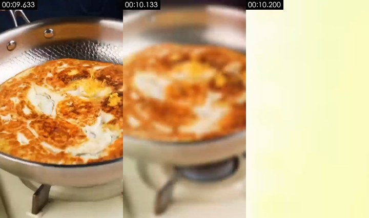

**Visible on screen** (check against the frames)
- Picture: Plan final sur la galette dorée dans la poêle
- Camera / lighting: medium close-up; moving camera (gimbal / handheld pan); soft frontal light (flat light); key light frontal (from the camera side; both sides of the subject about equally bright); lighting ratio about 1.1:1 (0.1 stops); soft light (almost no lit / shadow edge)
- Text track (text/bottom): titanoxfrance.com
- Text track (subtitle/middle): COMMANDEZ / MAINTENANT
- [AI assistant review] Mouvements physiques cohérents : la spatule glisse sous les œufs, le retournement en l'air a un flou de mouvement naturel et la face cuite est dorée de façon plausible
- [AI assistant review] Même poêle martelée, même gazinière blanche et même décor sombre sur tous les plans, sans déformation de la main ni du manche
- [AI assistant review] Profondeur de champ courte et lumière chaude de studio : allure de vidéo produit fournisseur, recadrée en 9:16 ; probabilité IA non nulle car l'image est très propre

**How it was made, as inferred by the tools** (inferred, not seen)
- Inference: live action 54%, AI-generated video 35%, 2D animation 3% (fused_agent)
- Material: the user's real material: live footage
- Basis (tool measurements, not necessarily visible to the eye):
  - Photographic texture: noise σ=0.31, 235 colours, 6% flat blocks

- Remake: Source is live action: reshoot per the shooting plan (shot size / camera setup / lighting); only fall back to AI image-to-video (first frame as reference) when a shoot is not possible; real material the user must supply: live footage (whole frame)

</details>

<details class="ref"><summary>#6 00:10.233–00:11.367 · code / template render</summary>

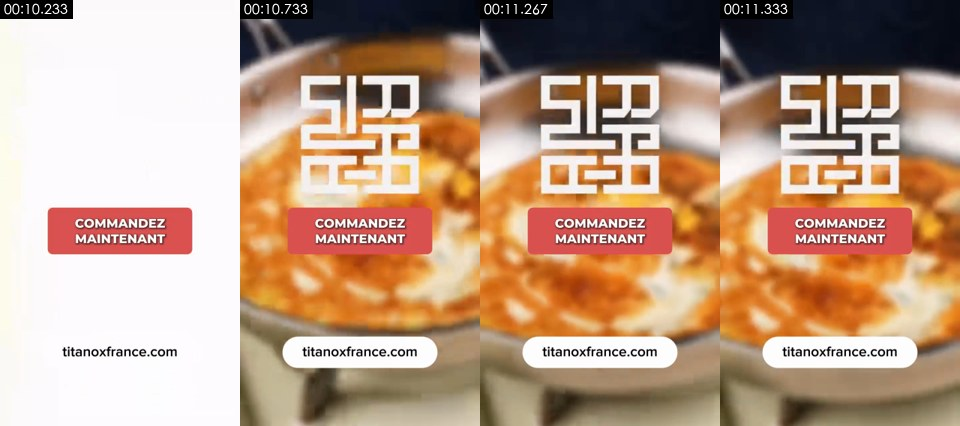

**Visible on screen** (check against the frames)
- Picture: Carte de fin : logo, bouton « Commandez maintenant », adresse du site sur fond dégradé rose
- Text track (text in the picture/bottom): titanoxfrance.com
- Text track (text in the picture/middle): COMMANDEZ / MAINTENANT
- [AI assistant review] Fond dégradé plat, logo et bouton vectoriels, texte net : carte de fin faite dans un éditeur ou en code

**How it was made, as inferred by the tools** (inferred, not seen)
- Inference: code / template render 80%, AI-generated video 5%, film / TV footage 4% (fused_agent)
- Material: rendered by the creator
- Basis (tool measurements, not necessarily visible to the eye):
  - Photographic texture: noise σ=0.21, 226 colours, 13% flat blocks

- Remake: Code render: rebuild in an HTML video framework (such as HyperFrames or Remotion) from the rhythm, key frames and layout, 100% controllable, no generative model needed

</details>

### Metadata clues

- Encoder: `AVC Coding`

### Notes

- Deterministic forensics is reliable on motion, whole-frame pan/zoom, rendered texture and 24→30 fps conversion; telling live action from AI from 3D needs image reading (a VLM or an AI assistant's review), and a look at the frames yourself.
- Platform transcoding usually strips metadata; missing metadata proves nothing.
- The full data is in `breakdown.json`; the package for models starts at `VIDEO.md`.

---

Made with [REA-VIDEO](https://github.com/JuneYaooo/rea-video) · https://github.com/JuneYaooo/rea-video
